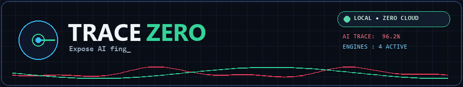
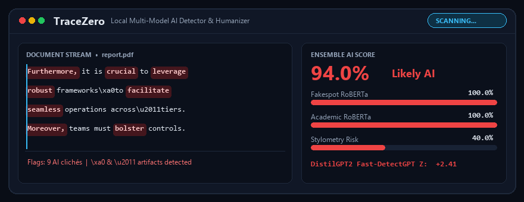
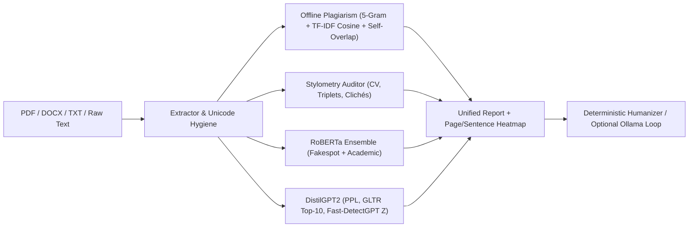
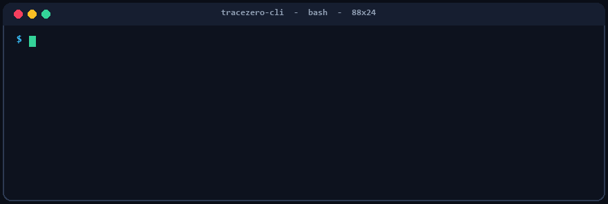

<div align="center">



<br />

<a href="https://codethief831.github.io/TraceZero/">
  
</a>

<br />

[](https://github.com/CodeThief831/TraceZero/actions/workflows/ci.yml)
[](https://www.python.org/)
[](#docker-setup-recommended-for-large-models)
[](#interactive-web-workbench--rest-api)
[](LICENSE)

<br />

[](https://github.com/CodeThief831/TraceZero/stargazers)
&nbsp;&nbsp;
[](https://github.com/sponsors/CodeThief831)
&nbsp;&nbsp;
[](https://codethief831.github.io/TraceZero/)

<h1>TraceZero — Open-Source Plagiarism Checker, AI Content Detector &amp; Humanizer</h1>

<p>
  <strong>The free, 100% local alternative to Turnitin, GPTZero, Copyleaks &amp; Originality.ai.</strong><br/>
  Combine cross-document <strong>n-gram + TF-IDF plagiarism checking</strong>, a <strong>Multi-RoBERTa AI classifier ensemble</strong>, <strong>Fast-DetectGPT DistilGPT2 perplexity scoring</strong>, <strong>PDF Unicode hygiene cleanup</strong>, and a <strong>text humanizer</strong> in one privacy-first toolkit.
</p>

<p>
  <a href="#live-forensic-motion-demo"><strong>Live Demo</strong></a> •
  <a href="#plagiarism-checker-n-gram--tf-idf--self-overlap"><strong>Plagiarism Checker</strong></a> •
  <a href="#architecture--pipeline"><strong>AI Detection Pipeline</strong></a> •
  <a href="#quickstart"><strong>CLI Quickstart</strong></a> •
  <a href="#docker-setup-recommended-for-large-models"><strong>Docker</strong></a> •
  <a href="#interactive-web-workbench--rest-api"><strong>Web UI &amp; API</strong></a> •
  <a href="#-monetization-pro-tiers--sponsorship"><strong>Pro &amp; Sponsor</strong></a>
</p>

</div>

---

## Live Forensic Motion Demo

<div align="center">
  
</div>

> **Why pay per-word SaaS fees or leak unpublished manuscripts to cloud databases?** TraceZero runs **Plagiarism Checking + AI Content Detection + Stylometry + Humanization** completely offline on your own CPU/GPU or private Docker server.

---

## TraceZero vs. Turnitin, GPTZero, Copyleaks & Basic Scripts

| Feature | Paid SaaS Scanners | Basic Scripts | **TraceZero (Open Source)** |
| :--- | :---: | :---: | :---: |
| **Offline N-Gram + TF-IDF Plagiarism Checker** (Files, Folders & Self-Overlap) | Cloud database only | No | **100% Local (`tracezero plagiarism`)** |
| **Multi-RoBERTa Neural AI Detector** (`fakespot` + `academic_det` + `chatgpt_roberta`) | Black-box | No | **Transparent Local Ensemble** |
| **DistilGPT2 Perplexity, GLTR Top-10 & Fast-DetectGPT Z-Score** | Hidden | No | **Computed Live Locally** |
| **Sentence Burstiness (`CV`), Triplet & AI Cliché Audit** | Partial | Basic | **Instant (`--fast` mode)** |
| **PDF / DOCX Invisible Unicode Hygiene (`\xa0`, `\u2011`, `\u200b`)** | Breaks silently | No | **Auto-Detected & Cleaned** |
| **Text Humanizer + Optional Local Ollama Loop** | Paid upsell | No | **Included (MIT)** |
| **Word Limits / Document Leaks / SaaS Lock-in** | Strict monthly caps | N/A | **Unlimited • Zero Cloud Calls** |

---

## Plagiarism Checker (N-Gram + TF-IDF + Self-Overlap)

TraceZero checks `.pdf`, `.docx`, `.txt`, `.md`, or raw text against any folder of reference files or pasted corpus text—completely offline:

- **5-Gram Shingle Containment:** Detects verbatim copied sentences and passage stitching, highlighting exact matched excerpts.
- **Pure-Python TF-IDF Cosine Similarity:** Flags lightly reordered or paraphrased overlap across large reference collections with zero heavy external dependencies.
- **Internal Self-Plagiarism Check:** Audits documents for duplicated copy-pasted paragraphs even when no external reference folder is supplied.

```bash
# Check a thesis PDF against an entire folder of reference PDFs & DOCX papers
tracezero plagiarism thesis.pdf --ref ./reference_papers/ --json-out plagiarism_report.json

# Compare inline draft text against multiple source files
tracezero plagiarism draft.txt --ref source_a.pdf --ref source_b.docx
```

---

## Architecture & Pipeline

<div align="center">
  
</div>

<details>
<summary><strong>Click to view Model Registry &amp; Signal Architecture</strong></summary>

### Supported Local Models (Stored Outside Git in `./models`)

| Key | Type | Size | Hugging Face Repository | Role |
| :--- | :---: | :---: | :--- | :--- |
| `fakespot` | Classifier | ~475 MB | `fakespot-ai/roberta-base-ai-text-detection-v1` | Primary modern multi-LLM vs. human RoBERTa detector |
| `academic_det` | Classifier | ~475 MB | `andreas122001/roberta-academic-detector` | Academic & formal technical prose RoBERTa detector |
| `chatgpt_roberta` | Classifier | ~475 MB | `Hello-SimpleAI/chatgpt-detector-roberta` | Optional lightweight HC3 baseline detector |
| `distilgpt2` | Causal LM | ~336 MB | `distilbert/distilgpt2` | Token perplexity, GLTR Top-10 predictability & Fast-DetectGPT curvature Z-score |

### Signal Graph



</details>

---

## Quickstart

<div align="center">
  
</div>

### 1. Clone & Install

```bash
git clone https://github.com/CodeThief831/TraceZero.git
cd TraceZero
python -m venv .venv
# Windows: .venv\Scripts\activate
# macOS/Linux: source .venv/bin/activate
pip install -e ".[dev]"
```

### 2. Download Model Weights (Kept Outside Git)

```bash
tracezero download-models
tracezero models
```

### 3. Scan for AI, Check Plagiarism & Humanize from CLI

```bash
# 1. Full AI detection + Fast-DetectGPT + stylometry + PDF hygiene scan
tracezero scan report.pdf --json-out audit.json

# 2. Plagiarism check against a reference directory
tracezero plagiarism report.pdf --ref ./papers/

# 3. Ultra-fast offline stylometry scan (no model downloads needed)
tracezero scan draft.txt --fast

# 4. Clean invisible PDF Unicode, remove AI filler, and show before/after delta
tracezero humanize report.pdf -o clean_draft.txt
```

<details>
<summary><strong>Click for full CLI Command &amp; Flag Reference</strong></summary>

| Command | Key Options | Description |
| :--- | :--- | :--- |
| `tracezero version` | — | Print installed version |
| `tracezero models` | — | Show model registry & whether each weight folder is cached locally |
| `tracezero download-models` | `[keys...]` | Download model weights (`fakespot academic_det distilgpt2` by default) |
| `tracezero scan <target>` | `--fast`, `--no-ppl`, `--model/-m`, `--json-out` | AI detection audit on `.pdf`, `.docx`, `.txt`, `.md`, or raw text |
| `tracezero plagiarism <target>` | `--ref/-r`, `--ngram/-n`, `--json-out` | N-gram shingling, TF-IDF cosine similarity & self-repetition audit |
| `tracezero humanize <target>` | `--out/-o`, `--fast` | Run deterministic hygiene/cadence pass and print before/after delta |
| `tracezero serve` | `--host`, `--port` | Start FastAPI server & interactive dark-mode Web Workbench |

</details>

---

## Docker Setup (Recommended for Large Models)

TraceZero builds into a slim Python 3.12 container while mounting `./models` as a host volume so multi-GB weights stay out of Git and container layers:

```bash
docker compose build
docker compose run --rm tracezero download-models
docker compose up -d
```

Open **[http://localhost:8000](http://localhost:8000)** for the Web UI, or run one-off CLI plagiarism/AI scans inside Docker:

```bash
docker run --rm \
  -v "${PWD}/models:/app/models" \
  -v "${PWD}:/data" \
  tracezero-tracezero plagiarism /data/report.pdf --ref /data/refs
```

---

## Interactive Web Workbench & REST API

```bash
tracezero serve --port 8000
```

Built into **[http://localhost:8000](http://localhost:8000)**:
- **Unified AI Detector + Plagiarism Checker + Humanizer UI:** Switch between AI scoring, cross-document plagiarism checks, self-overlap audits, and one-click cleaning.
- **Full REST API Ready for SaaS Wrapping:** Deploy behind Stripe/API keys cleanly with `/api/scan`, `/api/scan-file`, `/api/plagiarism`, `/api/plagiarism-files`, `/api/humanize`, and `/api/health`.

<details>
<summary><strong>Click to inspect FastAPI Endpoints</strong></summary>

| Method | Endpoint | Purpose |
| :--- | :--- | :--- |
| `GET` | `/` | Interactive TraceZero Web Workbench (AI Detector, Plagiarism & Humanizer) |
| `GET` | `/api/health` | Service status, version & local model cache availability |
| `POST` | `/api/scan` | JSON AI audit (`text`, `use_neural`, `use_perplexity`, `models`) |
| `POST` | `/api/scan-file` | Multipart document AI audit (`.pdf`, `.docx`, `.txt`, `.md`) |
| `POST` | `/api/plagiarism` | JSON plagiarism check (`text`, `references`, `ngram_size`) |
| `POST` | `/api/plagiarism-files` | Multipart plagiarism check (`candidate` file vs multiple `references` files) |
| `POST` | `/api/humanize` | Clean + re-score (`text`, `add_contractions`, `soften_em_dashes`, `rescore_neural`) |

</details>

---

## Python SDK

```python
from tracezero.detectors import analyze_file, compare_against_corpus, compare_texts
from tracezero.humanizer import humanize_text, rewrite_with_openai_compatible

# 1. Check Plagiarism against a local reference corpus folder
plag = compare_against_corpus("thesis.pdf", ref_paths=["./reference_papers"])
print(f"Similarity: {plag.overall_similarity_score}% | Originality: {plag.originality_score}%")

# 2. Multi-model AI Content Detection
ai_report = analyze_file("thesis.pdf")
print(f"AI Probability: {ai_report.overall_ai_score}% ({ai_report.verdict})")

# 3. Clean PDF Unicode & humanize prose (optional Ollama rewrite loop)
cleaned = humanize_text("Furthermore,\u00a0it is crucial to leverage robust solutions.")
print(cleaned.humanized_text)
```

---

## FAQ (Plagiarism, AI Detection & Privacy)

<details>
<summary><strong>Can TraceZero check plagiarism 100% free and offline without uploading my paper?</strong></summary>

Yes. Unlike cloud plagiarism checkers that archive submitted essays and charge per page, `tracezero plagiarism` and `POST /api/plagiarism-files` compute 5-gram shingling, TF-IDF cosine similarity, and self-overlap locally on your machine with zero network calls.
</details>

<details>
<summary><strong>Why do Turnitin and GPTZero flag clean human PDFs?</strong></summary>

PDF generators often inject invisible characters like non-breaking spaces (`\xa0`), non-breaking hyphens (`\u2011`), and zero-width joiners (`\u200b`) alongside flat formulaic transitions. TraceZero exposes and strips these anomalies before scoring.
</details>

<details>
<summary><strong>How can I monetize or deploy TraceZero commercially for my team or SaaS?</strong></summary>

TraceZero uses an MIT core license—you can self-host `docker compose up -d` behind an API gateway cleanly, or license our Pro/Enterprise deployment blueprints and custom tuning packages in [COMMERCIAL.md](COMMERCIAL.md).
</details>

---

## 💖 Monetization, Pro Tiers & Sponsorship

TraceZero follows an **Open-Core + Sponsorship** model ([full details in `COMMERCIAL.md`](COMMERCIAL.md)):

| Tier | Price | Included | Link |
| :--- | :---: | :--- | :--- |
| **Community (MIT)** | **\$0** | Full local CLI, Web UI, Docker, Plagiarism + AI Detection + Humanizer | [`CodeThief831/TraceZero`](https://github.com/CodeThief831/TraceZero) |
| **Pro Sponsor** | **\$19 / mo** | Priority multilingual/DeBERTa-v3 presets, batch audit recipes & priority support | [Sponsor on GitHub](https://github.com/sponsors/CodeThief831) |
| **Team / University On-Prem** | **\$199 / mo** | Air-gapped Docker architecture, multi-worker API scaling & corpus blueprint | [Request License](https://github.com/CodeThief831/TraceZero/issues/new?template=enterprise_inquiry.md) |
| **Enterprise White-Label / SaaS** | **Custom** | Turnkey Stripe/API gateway monetization wrapper & custom model tuning | [Commercial Inquiry](https://github.com/CodeThief831/TraceZero/issues/new?template=enterprise_inquiry.md) |

<div align="center">

[](https://github.com/CodeThief831/TraceZero)
&nbsp;&nbsp;
[](https://github.com/sponsors/CodeThief831)
&nbsp;&nbsp;
[](COMMERCIAL.md)

</div>

---

## Responsible Use & License

No automated plagiarism or AI-text detector achieves 100% precision. Plagiarism similarity scores measure lexical/structural overlap against supplied references and self-repetition, and AI probabilities should always be reviewed by a human editor rather than used as standalone proof of misconduct.

[MIT](LICENSE) — Copyright © 2026 [Sai Thilak T](https://github.com/CodeThief831)
