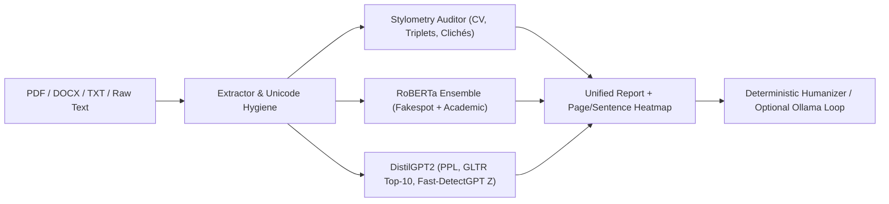

<div align="center">


# TraceZero

**Expose AI fingerprints. Restore human cadence.**  
*100% local multi-model AI text detector, Fast-DetectGPT perplexity auditor, PDF hygiene cleaner, and humanization workbench.*

[](https://github.com/CodeThief831/TraceZero/actions/workflows/ci.yml)
[](https://www.python.org/)
[](#docker-setup-recommended-for-large-models)
[](LICENSE)
[](https://github.com/CodeThief831/TraceZero/stargazers)
[](https://github.com/sponsors/CodeThief831)

[Quickstart](#quickstart) • [Docker Setup](#docker-setup-recommended-for-large-models) • [Web Workbench](#interactive-web-workbench) • [Architecture](#architecture) • [Python SDK](#python-sdk) • [Sponsor](#-support--sponsorship)

</div>

---

## Why TraceZero?

Cloud AI scanners hide their weights, limit daily word counts, and silently trip on invisible PDF encoding artifacts (`\xa0`, `\u2011`, zero-width spaces) injected by document generators. Meanwhile, naive scripts only grep for buzzwords.

**TraceZero** runs **four independent forensic signals locally** on your own machine—keeping your documents private and keeping heavy model weights completely outside Git:

| Capability | Cloud Scanners | Basic Scripts | **TraceZero** |
| :--- | :---: | :---: | :---: |
| **Multi-RoBERTa Neural Ensemble** (`fakespot` + `academic_det`) | Black-box | No | **Yes (Local)** |
| **DistilGPT2 Perplexity + Fast-DetectGPT Curvature Z-Score** | Hidden | No | **Yes (Local)** |
| **Sentence-Length Burstiness (`CV`), Triplet & Cliché Audit** | Partial | Basic | **Yes (`--fast`)** |
| **PDF / DOCX Invisible Unicode Hygiene (`\xa0`, `\u2011`, `\u200b`)** | Breaks silently | No | **Auto-Detected & Cleaned** |
| **Deterministic Humanizer + Optional Ollama / LLM Loop** | Paid upsell | No | **Included (MIT)** |
| **Zero-Bloat Docker Setup (Weights Mounted via Volume)** | N/A | N/A | **Yes (`docker compose`)** |

---

## Architecture



---

## Quickstart

### 1. Clone & Install

```bash
git clone https://github.com/CodeThief831/TraceZero.git
cd TraceZero
python -m venv .venv
# Windows: .venv\Scripts\activate
# macOS/Linux: source .venv/bin/activate
pip install -e ".[dev]"
```

### 2. Fetch Model Weights (Kept Outside Git)

TraceZero excludes all model weights from version control via `.gitignore` and streams them directly into `./models/` (or `$TRACEZERO_MODELS_DIR`) over HTTPS:

```bash
tracezero download-models
tracezero models
```

### 3. Scan & Humanize from the CLI

```bash
# Full neural + Fast-DetectGPT + stylometry + PDF hygiene scan
tracezero scan submission.pdf

# Instant offline scan (zero model weights needed)
tracezero scan draft.txt --fast

# Export full JSON breakdown
tracezero scan paper.docx --json-out audit.json

# Clean invisible Unicode, replace AI filler, and show before/after score
tracezero humanize draft.txt -o cleaned.txt
```

---

## Docker Setup (Recommended for Large Models)

Because transformer weights total ~1.3 GB across models, TraceZero keeps the **Docker image lean** and mounts `./models` as a persistent host volume—so you never rebuild huge multi-GB layers when updating code.

### 1. Build the Image

```bash
docker compose build
```

### 2. Download Models into the Mounted Volume (One-Time)

```bash
docker compose run --rm tracezero download-models
```

### 3. Start the Web Workbench

```bash
docker compose up -d
```

Open **[http://localhost:8000](http://localhost:8000)** in your browser.

### Run Single CLI Commands via Docker

```bash
# Scan a local file mounted into /data
docker run --rm -v "${PWD}/models:/app/models" -v "${PWD}:/data" tracezero-tracezero scan /data/report.pdf

# Check cached models inside volume
docker compose run --rm tracezero models
```

---

## Interactive Web Workbench

Launch locally without Docker:

```bash
tracezero serve --port 8000
```

Features inside the dark-mode FastAPI dashboard (`/`):
- **Live Text & File Upload:** Paste prose or drag-and-drop `.pdf`, `.docx`, `.txt`, or `.md` files.
- **Per-Model & Per-Page Breakdown:** Inspect `fakespot`, `academic_det`, `stylometry`, `DistilGPT2 Perplexity`, and `Fast-DetectGPT Z-score` side by side.
- **Sentence Heatmap & One-Click Humanize:** Highlights cliché phrases, rule-of-three triplets, and invisible PDF encoding flaws, then cleans and re-scores immediately.

---

## Python SDK

```python
from tracezero.detectors import analyze_file, analyze_text
from tracezero.humanizer import humanize_text, rewrite_with_openai_compatible

# 1. Audit a PDF or text
report = analyze_file("submission.pdf")
print(report.overall_ai_score, report.verdict)

# 2. Deterministic hygiene & humanization (offline, zero hallucinations)
cleaned = humanize_text("Furthermore,\u00a0it is crucial to leverage robust solutions.")
print(cleaned.humanized_text)

# 3. Optional detector-guided paragraph rewrite via local Ollama
rewritten = rewrite_with_openai_compatible(
    cleaned.humanized_text,
    model="llama3.1",
    base_url="http://localhost:11434/v1",
)
```

---

## Development & Tests

```bash
pytest -v
```

The test suite mocks heavy model downloads for CI speed while verifying extraction, Unicode normalization, stylometry, humanizer passes, CLI commands, and FastAPI routes.

---

## 💖 Support & Sponsorship

If **TraceZero** saved you hours of manual editing, kept your documents private, or helped your team ship cleaner writing:

- **Star this repository** on GitHub to help others discover local, open-source AI auditing!
- **Sponsor development** via [GitHub Sponsors (`@CodeThief831`)](https://github.com/sponsors/CodeThief831) to fund new model adapters (DeBERTa-v3 detectors, multilingual perplexity models, and desktop binaries) or reach out for custom enterprise/on-prem deployments.

---

## Responsible Use

No automated AI-text detector is 100% accurate—false positives occur on concise, formal, or non-native technical writing, and detector scores should never be treated as standalone proof of misconduct. TraceZero is designed as a transparent local auditing and editing aid.

## License

[MIT](LICENSE) — Copyright © 2026 [Sai Thilak T](https://github.com/CodeThief831)
