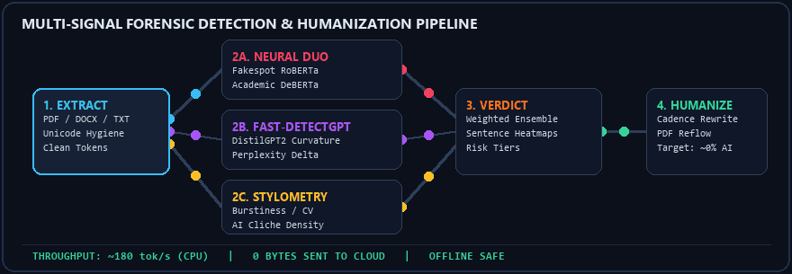
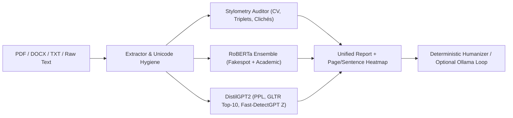

<div align="center">


<br />

<a href="https://github.com/CodeThief831/TraceZero">
  
</a>

<br />

[](https://github.com/CodeThief831/TraceZero/actions/workflows/ci.yml)
[](https://www.python.org/)
[](#docker-setup-recommended-for-large-models)
[](#interactive-web-workbench--api)
[](LICENSE)

<br />

[](https://github.com/CodeThief831/TraceZero/stargazers)
&nbsp;&nbsp;
[](https://github.com/sponsors/CodeThief831)
&nbsp;&nbsp;
[](https://github.com/CodeThief831/TraceZero/network/members)

<p>
  <a href="#live-forensic-motion-demo"><strong>Live Demo</strong></a> •
  <a href="#architecture--pipeline"><strong>Pipeline</strong></a> •
  <a href="#quickstart"><strong>CLI Quickstart</strong></a> •
  <a href="#docker-setup-recommended-for-large-models"><strong>Docker</strong></a> •
  <a href="#interactive-web-workbench--api"><strong>Web UI & API</strong></a> •
  <a href="#python-sdk"><strong>Python SDK</strong></a> •
  <a href="#-star--sponsor"><strong>Sponsor</strong></a>
</p>

</div>

---

## Live Forensic Motion Demo

<div align="center">
  
</div>

> **TraceZero** audits documents across **four independent signals** on your own hardware—catching statistical uniformity, neural classifier peaks, cliché triplets, and hidden PDF Unicode artifacts—then strips those fingerprints and re-scores in real time.

---

## Why TraceZero?

Most web AI checkers lock weights behind a black box, monetize per 500 words, and silently choke on invisible formatting bytes (`\xa0`, `\u2011`, `\u200b`) emitted by PDF exporters. Meanwhile, naive Python scripts only grep a handful of words.

| Capability | Cloud Scanners | Basic Scripts | **TraceZero** |
| :--- | :---: | :---: | :---: |
| **Multi-RoBERTa Neural Ensemble** (`fakespot` + `academic_det` + `chatgpt_roberta`) | Black-box | No | **Local Weights** |
| **DistilGPT2 Perplexity, GLTR Top-10 & Fast-DetectGPT Z-Score** | Hidden | No | **Computed Live** |
| **Sentence Burstiness (`CV`), Triplet & AI Cliché Density** | Partial | Basic | **Instant (`--fast`)** |
| **PDF / DOCX Invisible Unicode Hygiene (`\xa0`, `\u2011`, `\u200b`)** | Breaks silently | No | **Auto-Detected & Cleaned** |
| **Deterministic Humanizer + Optional Local Ollama Loop** | Paid upsell | No | **Built-in (MIT)** |
| **Zero-Bloat Docker Setup (Models Mounted via Volume)** | N/A | N/A | **`docker compose up`** |
| **100% Private (Zero Documents Uploaded to Any Cloud API)** | Uploads your IP | Usually | **Zero Cloud Calls** |

---

## Architecture & Pipeline

<div align="center">
  
</div>

<details>
<summary><strong>Click to view Model Registry & Mermaid Signal Graph</strong></summary>

### Supported Local Models (Stored Outside Git in `./models`)

| Key | Type | Size | Hugging Face Repository | Role |
| :--- | :---: | :---: | :--- | :--- |
| `fakespot` | Classifier | ~475 MB | `fakespot-ai/roberta-base-ai-text-detection-v1` | Primary modern multi-LLM vs. human RoBERTa detector |
| `academic_det` | Classifier | ~475 MB | `andreas122001/roberta-academic-detector` | Academic & formal technical prose RoBERTa detector |
| `chatgpt_roberta` | Classifier | ~475 MB | `Hello-SimpleAI/chatgpt-detector-roberta` | Optional lightweight HC3 baseline detector |
| `distilgpt2` | Causal LM | ~336 MB | `distilbert/distilgpt2` | Token perplexity, GLTR Top-10 predictability & Fast-DetectGPT curvature Z-score |

### Signal Graph



</details>

---

## Quickstart

<div align="center">
  
</div>

### 1. Clone & Install

```bash
git clone https://github.com/CodeThief831/TraceZero.git
cd TraceZero
python -m venv .venv
# Windows: .venv\Scripts\activate
# macOS/Linux: source .venv/bin/activate
pip install -e ".[dev]"
```

### 2. Download Model Weights (Kept Outside Git)

Weights live in `./models/` (or `$TRACEZERO_MODELS_DIR`), completely ignored by `.gitignore` so the repository stays featherweight:

```bash
tracezero download-models
tracezero models
```

### 3. Run Scans & Humanize from CLI

```bash
# Full neural + DistilGPT2 Fast-DetectGPT + stylometry + PDF hygiene audit
tracezero scan report.pdf --json-out audit.json

# Ultra-fast offline scan (stylometry + hygiene only, no weights needed)
tracezero scan draft.txt --fast

# Clean invisible Unicode, strip AI filler, and show before/after score
tracezero humanize report.pdf -o clean_draft.txt
```

<details>
<summary><strong>Click for full CLI Command & Flag Reference</strong></summary>

| Command | Key Options | Description |
| :--- | :--- | :--- |
| `tracezero version` | — | Print installed version |
| `tracezero models` | — | Show model registry & whether each weight folder is cached locally |
| `tracezero download-models` | `[keys...]` | Download model weights (`fakespot academic_det distilgpt2` by default) |
| `tracezero scan <target>` | `--fast`, `--no-ppl`, `--model/-m`, `--json-out` | Audit `.pdf`, `.docx`, `.txt`, `.md`, or raw text |
| `tracezero humanize <target>` | `--out/-o`, `--fast` | Run deterministic hygiene/cadence pass and print before/after delta |
| `tracezero serve` | `--host`, `--port` | Start FastAPI server & interactive dark-mode Web Workbench |

</details>

---

## Docker Setup (Recommended for Large Models)

Because transformer weights total ~1.3 GB, TraceZero uses a **slim Python 3.12 Docker image** (`~300 MB` code + CPU PyTorch) and mounts `./models` from your host—so rebuilding after code updates takes seconds.

```bash
# 1. Build the slim container
docker compose build

# 2. Fetch models once into your host ./models/ directory
docker compose run --rm tracezero download-models

# 3. Launch the Web Workbench at http://localhost:8000
docker compose up -d
```

Run a one-off CLI file audit inside the container without starting the daemon:

```bash
docker run --rm \
  -v "${PWD}/models:/app/models" \
  -v "${PWD}:/data" \
  tracezero-tracezero scan /data/report.pdf --json-out /data/audit.json
```

---

## Interactive Web Workbench & API

Start locally without Docker:

```bash
tracezero serve --port 8000
```

Open **[http://localhost:8000](http://localhost:8000)** for the dark-mode FastAPI workbench:
- **Drag-and-Drop Documents & Live Text:** Supports `.pdf`, `.docx`, `.txt`, `.md`, and raw prose.
- **Multi-Signal Telemetry:** Inspect `fakespot`, `academic_det`, `DistilGPT2 Perplexity`, `Fast-DetectGPT Z-score`, and `stylometry` side-by-side.
- **Sentence Heatmaps & One-Click Clean:** Flag high-probability sentences, highlight clichés/em-dashes/triplets, and clean + re-score instantly.

<details>
<summary><strong>Click to inspect REST API Endpoints</strong></summary>

| Method | Endpoint | Purpose |
| :--- | :--- | :--- |
| `GET` | `/` | Interactive TraceZero Web Workbench UI |
| `GET` | `/api/health` | Service status, version, and local model cache availability |
| `POST` | `/api/scan` | JSON audit (`text`, `use_neural`, `use_perplexity`, `models`) |
| `POST` | `/api/scan-file` | Multipart file upload (`.pdf`, `.docx`, `.txt`, `.md`) |
| `POST` | `/api/humanize` | Clean + re-score (`text`, `add_contractions`, `soften_em_dashes`, `rescore_neural`) |

</details>

---

## Python SDK

```python
from tracezero.detectors import analyze_file, analyze_text
from tracezero.humanizer import humanize_text, rewrite_with_openai_compatible

# 1. Full forensic scan on a PDF submission
report = analyze_file("submission.pdf")
print(f"Score: {report.overall_ai_score}% ({report.verdict})")

# 2. Deterministic Unicode & cliché cleanup (100% offline, zero hallucinations)
cleaned = humanize_text("Furthermore,\u00a0it is crucial to leverage robust solutions.")
print(cleaned.humanized_text)

# 3. Optional detector-guided cadence rewrite via local Ollama / OpenAI-compatible endpoint
rewritten = rewrite_with_openai_compatible(
    cleaned.humanized_text,
    model="llama3.1",
    base_url="http://localhost:11434/v1",
)
```

---

## Development & Verification

```bash
pytest -v
```

Heavy model downloads are mocked in the test suite so CI verifies PDF/DOCX extraction, Unicode normalization, stylometry math, humanizer transformations, CLI commands, and FastAPI endpoints in seconds.

---

## 💖 Star & Sponsor

If **TraceZero** helped you audit a manuscript, catch hidden AI fingerprints, or keep sensitive documents off third-party clouds:

<div align="center">

[](https://github.com/CodeThief831/TraceZero)
&nbsp;&nbsp;
[](https://github.com/sponsors/CodeThief831)

</div>

Sponsorship funds **DeBERTa-v3 detector adapters**, **multilingual perplexity models**, **GPU/ONNX acceleration**, and **enterprise/on-prem consulting** ([`FUNDING.yml`](.github/FUNDING.yml)).

---

## Responsible Use

No automated AI-text detector achieves 100% precision. False positives occur on concise, formal, or non-native technical writing, and detector probabilities must never serve as standalone proof of misconduct. TraceZero is intended as a transparent, local writing audit and quality workbench.

## License

[MIT](LICENSE) — Copyright © 2026 [Sai Thilak T](https://github.com/CodeThief831)
