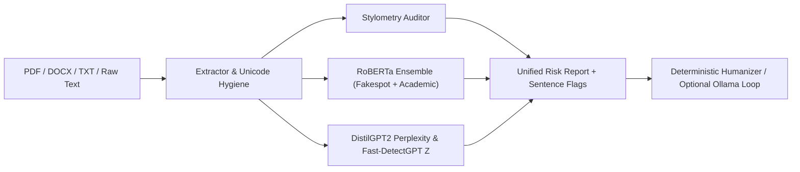

# HumanLens

**Local, open-source AI text detection, Fast-DetectGPT perplexity auditing, PDF encoding hygiene checking, and humanization workbench.**

HumanLens runs **100% locally** on CPU or GPU with zero third-party SaaS lock-in, keeping heavy model weights strictly separate from source code (`models/` is gitignored and fetched on demand).

---

## Why HumanLens?

Most lightweight scripts only grep for buzzwords, while online AI scanners hide how they score documents—and silently trip over invisible PDF encoding glitches like non-breaking spaces (`\xa0`) or non-breaking hyphens (`\u2011`).

HumanLens combines **four independent signals** into one unified report:

1. **Neural Classifier Ensemble** — runs modern sequence classifiers (`fakespot-ai/roberta-base-ai-text-detection-v1`, `andreas122001/roberta-academic-detector`, and optional `Hello-SimpleAI/chatgpt-detector-roberta`) across pages and chunked windows.
2. **Perplexity & Fast-DetectGPT Curvature** — uses `distilgpt2` to measure token perplexity, sentence-level perplexity variance, GLTR Top-10 predictability, and Fast-DetectGPT analytical conditional-probability Z-scores.
3. **Linguistic Stylometry** — computes sentence-length burstiness (`CV`), repeated sentence starters, rule-of-three triplets, em-dash density, contractions, and AI-overused transitions.
4. **PDF / DOCX Unicode Hygiene** — flags invisible characters (`\xa0`, `\u2011`, zero-width spaces) injected by PDF generators that break word boundaries, and normalizes them cleanly.

---

## Architecture



---

## Quick Start

### 1. Install

```bash
git clone https://github.com/<your-username>/HumanLens.git
cd HumanLens
python -m venv .venv
# Windows: .venv\Scripts\activate
# Linux/macOS: source .venv/bin/activate
pip install -e ".[dev]"
```

### 2. Download Model Weights (Kept Outside Git)

Model weights are stored in `./models/` (or `$HUMANLENS_MODELS_DIR`), which is excluded via `.gitignore`. Fetch them cleanly over direct HTTPS streaming:

```bash
humanlens download-models
```

Check locally cached models anytime:

```bash
humanlens models
```

---

## Usage

### CLI Scanning

```bash
# Full neural + perplexity + stylometry + PDF hygiene scan
humanlens scan report.pdf

# Fast offline scan (stylometry + Unicode hygiene only, zero model weights)
humanlens scan notes.txt --fast

# Export full JSON breakdown
humanlens scan essay.docx --json-out audit.json
```

### Humanizer & Hygiene Pass

```bash
# Clean PDF encoding artifacts, replace AI filler, and show before/after score
humanlens humanize draft.txt -o cleaned.txt
```

### Interactive Web Workbench (FastAPI)

```bash
humanlens serve --port 8000
```

Open `http://127.0.0.1:8000` in your browser to paste prose or upload `.pdf`, `.docx`, `.txt`, or `.md` files, inspect per-page and sentence-level flags, and run one-click humanization.

### Python SDK

```python
from humanlens.detectors import analyze_file, analyze_text
from humanlens.humanizer import humanize_text

report = analyze_file("submission.pdf")
print(report.overall_ai_score, report.verdict)

cleaned = humanize_text("Furthermore, it is crucial to leverage robust solutions.")
print(cleaned.humanized_text)
```

---

## Optional LLM-Assisted Paragraph Rewriting

HumanLens ships with a deterministic, zero-hallucination rule engine (`humanlens.humanizer.rules`) that works offline. If you also want iterative paragraph rewriting backed by a local **Ollama** instance or OpenAI-compatible server:

```python
from humanlens.humanizer import rewrite_with_openai_compatible

rewritten = rewrite_with_openai_compatible(
    flagged_paragraph,
    model="llama3.1",
    base_url="http://localhost:11434/v1",
)
```

---

## Running Tests

```bash
pytest -v
```

Tests cover extraction, Unicode hygiene normalization, stylometry metrics, rule-based humanization, pipeline aggregation (with mocked classifiers for fast CI), and FastAPI web endpoints.

---

## Responsible Use

No AI-text detector is infallible—false positives happen on concise, formal, or non-native academic prose, and detectors should never be used as sole proof of misconduct. HumanLens is built to help writers and reviewers **audit predictability, fix formatting artifacts, and improve clarity** transparently on their own machine.

## License

MIT — see [LICENSE](LICENSE).
